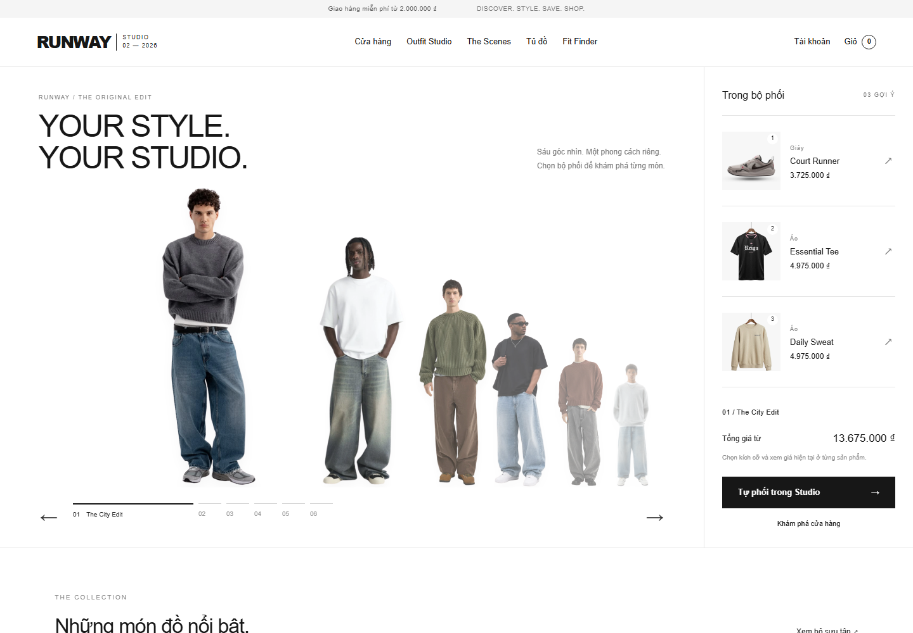

# Runway Studio 2.0

[Live Demo](https://runwaystudio-portfolio-demo.onrender.com) · [Mã nguồn GitHub](https://github.com/nguyenhonggiang2407/RunwayStudio) · [CI đã xác minh](https://github.com/nguyenhonggiang2407/RunwayStudio/actions/runs/41720242244)

**Discover, Style, Save & Shop** — một ứng dụng thương mại thời trang với Outfit Studio và Shop The Scene. Nâng cấp tăng dần từ project Java trong `RunwayStore_Fullstack_Source(1).zip`; giữ package `vn.runway.store`, session/CSRF và các API mua hàng cũ.



Ảnh **City Notes** mới trên trang chủ là ảnh chụp thật được cấp phép từ Jonnas Duarte / Pexels, lưu local dạng WebP responsive. [Nguồn, điều kiện và checksum](docs/MEDIA_LICENSES.md). Các ảnh kế thừa vẫn được giữ nguyên và còn cần xác nhận quyền sử dụng; ảnh editorial không đại diện cho sản phẩm trong catalog.

## Live Demo

Mở [Runway Studio trên Render](https://runwaystudio-portfolio-demo.onrender.com) để khám phá cửa hàng, Outfit Studio và Shop The Scene. Đăng ký một tài khoản khách mới để thử giỏ hàng và checkout COD bằng thông tin giả; mật khẩu **local demo** bên dưới không dùng được trên bản public.

Bản portfolio dùng **Render Free** và H2 trong bộ nhớ. Dịch vụ có thể ngủ khi không có truy cập nên lần mở đầu có thể chậm; dữ liệu tài khoản, đơn hàng và nội dung đã lưu sẽ mất khi dịch vụ khởi động lại hoặc triển khai lại. Không nhập dữ liệu cá nhân, thanh toán hay đặt giao hàng thật. Xem [cấu hình và giới hạn demo](docs/RENDER_FREE_DEMO.md).

## Chạy nhanh

Cần **JDK 17**. Maven Wrapper tải Maven tự động trong lần đầu; không cần Node để chạy website.

Unix/macOS:

```sh
./mvnw clean verify
java -jar target/runway-store-2.0.0.jar
```

Windows PowerShell:

```powershell
.\mvnw.cmd clean verify
java -jar target\runway-store-2.0.0.jar
```

Mở **http://localhost:8080**. Có thể chạy `RUN_DEMO.sh` hoặc `RUN_DEMO.bat`. Với JAR tải riêng: `java -jar runway-store-2.0.0.jar`.

Profile mặc định `demo` dùng H2 lưu tại `data/runway`, chỉ lắng nghe loopback. Tài khoản **chỉ dành cho local demo**:

| Quyền | Email | Mật khẩu local |
|---|---|---|
| Khách | demo@runway.local | Demo@12345 |
| Admin | admin@runway.local | Admin@12345 |

Không đưa cấu hình `demo` mặc định lên host public. [Blueprint Render Free](docs/RENDER_FREE_DEMO.md) dùng riêng cho demo tạm thời: ghi đè binding, bật cookie HTTPS, dùng H2 trong bộ nhớ và mật khẩu ngẫu nhiên do Render sinh. Với dữ liệu cần lưu lâu dài, dùng profile `mysql,prod` để tắt seed, cấu hình DB và cookie HTTPS; không có mật khẩu admin mặc định. Đọc [hướng dẫn triển khai](docs/DEPLOYMENT.md) để tạo admin lần đầu bằng thông tin riêng.

## Chức năng hiện có

| Nhóm | Hành vi |
|---|---|
| Cửa hàng | Tìm kiếm, lọc danh mục/giá/tồn, phân trang và sắp xếp tại DB; truy vấn variant theo batch |
| Giỏ hàng | Giỏ khách trong session; giỏ đăng nhập lưu DB, ghép guest một lần; thêm nhiều dòng nguyên tử |
| Checkout | COD, snapshot giá, khóa tồn kho, idempotency theo tài khoản; retry đơn cũ giữ giỏ mới |
| Đơn hàng | Lịch sử trạng thái; chuyển trạng thái hợp lệ; hủy và hoàn tồn đúng một lần |
| Outfit Studio | Áo/quần/giày/phụ kiện, chọn size, đổi thứ tự; lưu/tải outfit riêng tư; admin curated/public; add-all |
| Shop The Scene | Ảnh minh họa gắn hotspot theo %, xem giá/tồn thật; admin kéo hoặc dùng phím/nhập tọa độ, draft/publish |
| My Wardrobe | Lưu sản phẩm có hoặc không chọn variant; không trùng; cách ly dữ liệu theo tài khoản |
| Fit Finder | Rule theo vòng ngực, vòng eo hoặc chiều dài bàn chân; giải thích, biên rõ; không lưu số đo |
| Commerce | Sổ địa chỉ; voucher hạn dùng/ngưỡng/cap/lượt dùng; quote không tiêu thụ ưu đãi |
| Admin | CRUD sản phẩm/variant; audit thay đổi; ledger tồn; doanh thu chỉ đơn đã giao; báo cáo ngày UTC qua API |

Seed mới có 11 sản phẩm, 50 variant, 1 outfit curated, 3 scenes và 4 bảng size. Giữ ID và slug của 9 sản phẩm cũ để tương thích; thêm quần và túi để phối đủ bộ. Tất cả sản phẩm, giá và bảng size là dữ liệu minh họa.

## Kiểm thử

Minh chứng mới cho ảnh editorial và kiểm thử ngày **03–04/11/2026** nằm trong [VALIDATION](docs/VALIDATION.md): Maven 94 test và browser 18 test trên ứng dụng Java thật. Kết quả local, CI và deployment được ghi riêng.

```sh
./mvnw clean verify
npm ci
npm run check
npx playwright install chromium
npm run test:e2e
```

Playwright mở ứng dụng Java thật bằng H2 tạm tại cổng 4187; chạy desktop 1440 và mobile 390/360, không truy cập database người dùng. Các mật khẩu trong test là fixture dùng cho tiến trình test riêng.

MySQL acceptance chạy trong schema rỗng dùng riêng cho test:

```sh
# Export DB_URL, LEGACY_DB_URL, DB_USERNAME, DB_PASSWORD tới hai schema tạm riêng biệt.
./mvnw -Pmysql-verify verify
```

Xem [TEST_CASES](docs/TEST_CASES.md) và [DEPLOYMENT](docs/DEPLOYMENT.md) trước khi chạy migration trên dữ liệu cũ.

## Kiến trúc và quyết định

Java 17 · Spring Boot 3.5.16 · Spring Security · JPA · Flyway · MySQL 8.4/H2 · HTML/CSS/ES modules. Modular monolith, giữ session+CSRF cùng domain, không thêm JWT hoặc microservices cho dữ liệu demo.

- [Architecture](docs/ARCHITECTURE.md) · [ERD](docs/ERD.md) · [API](docs/API.md)
- [Security](docs/SECURITY.md) · [Baseline](docs/BASELINE.md) · [Roadmap](docs/ROADMAP.md)
- [Nguồn và tài nguyên](docs/ATTRIBUTION.md) · [Third-party notices](THIRD_PARTY_NOTICES.md)
- [Kịch bản demo 3–5 phút](docs/demo-script.md)

## Phạm vi chưa hoàn tất

Chưa tích hợp thanh toán sandbox, email, quy trình trả hàng, upload ảnh người dùng, tài khoản nhân viên nhiều cấp hoặc ML/AR. Fit Finder dùng bảng minh họa. UI Studio hiện tải tối đa 60 sản phẩm; API catalog có phân trang nhưng bộ chọn Studio cho catalog lớn còn là backlog. Admin UI dùng danh sách tối đa 60 sản phẩm/đơn; API phân trang riêng đã có. Chưa đo Lighthouse/coverage. Bản Live Demo dùng Docker trên Render Free với dữ liệu tạm thời; xem giới hạn ở đầu README. GitHub Actions đã chạy thành công trên mã nguồn public; xem [lần chạy đã xác minh](https://github.com/nguyenhonggiang2407/RunwayStudio/actions/runs/41580405057).

Quét dependency còn hiển thị hai advisory trên Spring MVC 6.2.19; đánh giá điều kiện không áp dụng cho ứng dụng được lưu cùng test và ngày hết hạn, **không xóa cảnh báo khỏi báo cáo**. Spring Boot 3.5 đã hết OSS support; kế hoạch nâng major cần một thay đổi riêng sau release core, theo ràng buộc giữ 3.5.x của roadmap.

Theo yêu cầu khôi phục ảnh gốc, bản hiện tại chứa 140 ảnh upstream nguyên byte tại `static/media/original/` (55.000.817 byte); đủ 140 SHA-256 khớp inventory ZIP gốc. Manifest `src/main/resources/original-photo-manifest.json` ghi đường dẫn, checksum và nguồn tại commit `e0219d0082e31af42438ad787a73b988d5e2fa16` của IdeaToCodee/runway. Chỉ ảnh được khôi phục; HTML, font, tracker, payment script và implementation trải nghiệm upstream vẫn không được phân phối. Hai sản phẩm bổ sung Straight Trousers và Weekend Tote không có ảnh gốc, tiếp tục dùng SVG minh họa. Không có LICENSE bao trùm được xác nhận; attribution và checksum không xác nhận quyền sở hữu hoặc quyền cấp phép lại ảnh. Xem [nguồn và tài nguyên](docs/ATTRIBUTION.md) và [Third-party notices](THIRD_PARTY_NOTICES.md).
