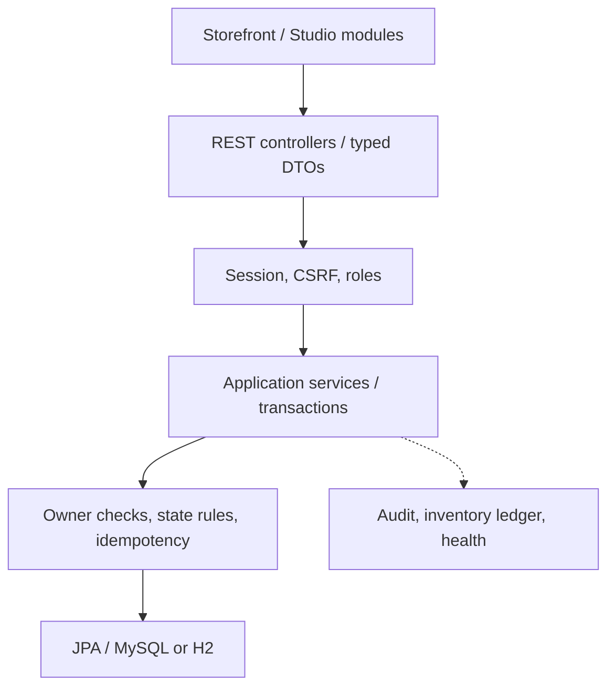

# Architecture

Modular monolith cùng package `vn.runway.store`, nhóm theo layer hiện có. Database là nguồn sự thật về giá, quyền sở hữu và tồn kho; browser chỉ gửi định danh, số lượng và lựa chọn.

## Các transaction quan trọng

- Checkout khóa account trước để nối idempotency và giỏ DB giữa các session. Kiểm tra requestKey cũ trước khi chạm giỏ. Variant khóa theo ID tăng dần. Tính giá, discount, phí; ghi order/line, giảm tồn, ledger, redemption và history trong cùng transaction. Giỏ chỉ bị consume khi tạo order mới. Exception rollback toàn bộ.
- Hủy khóa order; kiểm tra owner và transition; khóa variant cùng thứ tự; hoàn tồn và history cùng transaction. Hủy lặp không được đi qua transition lần hai.
- Giỏ account khóa account khi ghi/merge. Batch tạo candidate, validate toàn bộ trước khi thay giỏ. Guest cart được phục hồi khi transaction merge rollback. Guest vẫn là session, chỉ giỏ tài khoản tồn tại sau session.
- Outfit/scene update dùng lock và version do client gửi; cập nhật `updatedAt` để edit chỉ đổi item/hotspot vẫn tăng version. Controller public không trả draft/private của người khác; admin curated dùng endpoint riêng.
- Wishlist khóa account và có unique DB với `variantKey=0` cho variant null. Không phụ thuộc cách DB xử lý unique null.

## Query và frontend

Catalog dùng Criteria cho search/filter/sort/paging DB, sau đó lấy tất cả variant cho trang bằng một truy vấn IN. Trang đầy đủ dùng ba statement: products, count, variants. Không trả JPA entity trực tiếp qua các REST controller.

`js/app.js` ghép route và sự kiện chung. `core/` có API/CSRF/state/UI; `pages/` giữ storefront; `studio/` có outfit/scene/admin/wardrobe/fit. Không override `window.fetch`. Legacy `/cart/add.js` gọi batch service, các URL trải nghiệm cũ redirect tới Studio/Scenes mới.

Hạn chế đã biết: batch catalog được tối ưu, nhưng list outfit/scene/order còn tải detail theo từng record. UI admin/Studio bị giới hạn 60 record, cần paging UI tiếp khi dữ liệu lớn.
