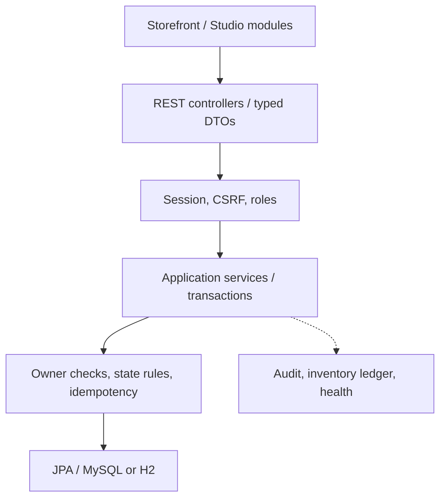
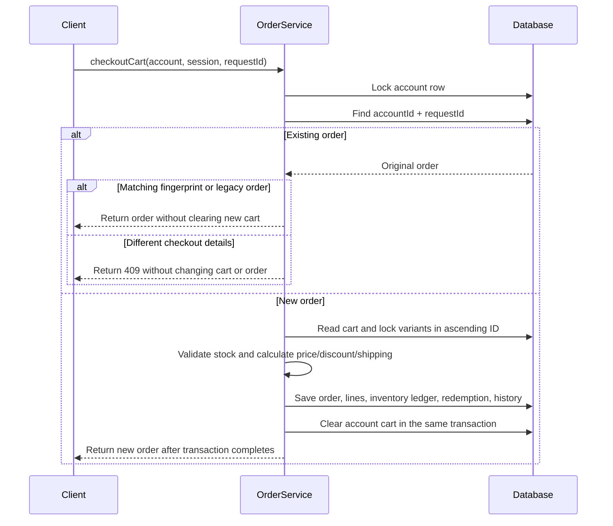

# Architecture

Modular monolith cùng package `vn.runway.store`, nhóm theo layer hiện có. Database là nguồn sự thật về giá, quyền sở hữu và tồn kho; browser chỉ gửi định danh, số lượng và lựa chọn.

## Các transaction quan trọng

- Checkout khóa account trước để nối idempotency và giỏ DB giữa các session. Kiểm tra requestKey cũ trước khi chạm giỏ. Variant khóa theo ID tăng dần. Tính giá, discount, phí; ghi order/line, giảm tồn, ledger, redemption và history trong cùng transaction. Giỏ chỉ bị consume khi tạo order mới. Exception rollback toàn bộ.
- Hủy khóa order; kiểm tra owner và transition; khóa variant cùng thứ tự; hoàn tồn và history cùng transaction. Hủy lặp không được đi qua transition lần hai.
- Giỏ account khóa account khi ghi/merge. Batch tạo candidate, validate toàn bộ trước khi thay giỏ. Guest cart được phục hồi khi transaction merge rollback. Guest vẫn là session, chỉ giỏ tài khoản tồn tại sau session.
- Outfit/scene update dùng lock và version do client gửi; cập nhật `updatedAt` để edit chỉ đổi item/hotspot vẫn tăng version. Controller public không trả draft/private của người khác; admin curated dùng endpoint riêng.
- Wishlist khóa account và có unique DB với `variantKey=0` cho variant null. Không phụ thuộc cách DB xử lý unique null.

## Query và frontend

Catalog dùng Criteria cho search/filter/sort/paging DB, sau đó lấy tất cả variant cho trang bằng một truy vấn IN. Trang đầy đủ dùng ba statement: products, count, variants. Không trả JPA entity trực tiếp qua các REST controller.

`js/app.js` ghép route và sự kiện chung. `core/` có API/CSRF/state/UI; `pages/` giữ storefront; `studio/` có outfit/scene/admin/wardrobe/fit. Không override `window.fetch`. Legacy `/cart/add.js` gọi batch service, các URL trải nghiệm cũ redirect tới Studio/Scenes mới.

Hạn chế đã biết: batch catalog được tối ưu, nhưng list outfit/scene/order còn tải detail theo từng record. UI admin/Studio bị giới hạn 60 record, cần paging UI tiếp khi dữ liệu lớn.

## Checkout: đường đọc mã và bằng chứng

Bắt đầu từ [OrderService](../src/main/java/vn/runway/store/service/OrderService.java), rồi đối chiếu [AccountRepository](../src/main/java/vn/runway/store/repository/AccountRepository.java), [VariantRepository](../src/main/java/vn/runway/store/repository/VariantRepository.java) và [ShopOrder](../src/main/java/vn/runway/store/model/ShopOrder.java). Hai repository dùng `PESSIMISTIC_WRITE`; `requestKey` của đơn hàng có ràng buộc unique.

Account lock tuần tự hóa checkout và giỏ DB của cùng tài khoản. Variant lock bảo vệ tồn kho khi các tài khoản khác nhau mua cùng phân loại. Thứ tự ID nhất quán giảm nguy cơ deadlock giữa các giỏ nhiều dòng; đây không phải cam kết loại bỏ mọi deadlock hoặc chứng minh thông lượng sản xuất.

Idempotency tra theo `accountId:requestId` trước khi đọc giỏ. Đơn mới lưu SHA-256 của thông tin checkout đã chuẩn hóa. Nếu fingerprint khác, server trả `409`. Đơn trước migration V4 giữ hành vi replay theo ID để tương thích. Giỏ hiện tại có thể đã thay đổi sau lần mua nên fingerprint chỉ dùng dữ liệu trong request checkout. Client giữ ID khi gửi lại cùng yêu cầu và tạo ID mới cho lần mua mới.

| Hành vi cần xem | Test có trong mã nguồn |
| --- | --- |
| Mười tài khoản tranh một sản phẩm cuối | [MySqlAcceptanceIT](../src/test/java/vn/runway/store/MySqlAcceptanceIT.java): `tenBuyersCompeteForLastItem` |
| Nhiều retry cùng key chỉ tạo một đơn | [MySqlAcceptanceIT](../src/test/java/vn/runway/store/MySqlAcceptanceIT.java): `concurrentRetriesCreateOneOrder` |
| Hủy đồng thời chỉ hoàn tồn một lần | [MySqlAcceptanceIT](../src/test/java/vn/runway/store/MySqlAcceptanceIT.java): `concurrentCancellationRestocksOnce` |
| Retry đơn cũ giữ giỏ mới ở session khác | [CommerceIntegrationTest](../src/test/java/vn/runway/store/CommerceIntegrationTest.java): `oldRetryDoesNotEraseNewPersistentCartInAnotherSession` |
| Cùng key nhưng khác thông tin checkout trả 409 và giữ nguyên giỏ | [CommerceIntegrationTest](../src/test/java/vn/runway/store/CommerceIntegrationTest.java): `sameCheckoutKeyRejectsChangedFieldsWithoutChangingCartOrOrder` |
| Checkout thiếu tồn không tạo đơn | [StoreIntegrationTest](../src/test/java/vn/runway/store/StoreIntegrationTest.java): `failedCheckoutRollsBackAllStock` |

Các test MySQL chạy qua profile `mysql-verify`; cần hai schema tạm riêng theo [DEPLOYMENT](DEPLOYMENT.md). [Workflow](../.github/workflows/ci.yml) tách MySQL, Java/browser và quét secret thành các job; xem [kết quả Actions](https://github.com/nguyenhonggiang2407/RunwayStudio/actions/workflows/ci.yml) để phân biệt test có trong mã với test đã chạy. Các trường hợp hữu hạn này không thay thế kiểm thử tải hoặc audit production.

[Baseline](BASELINE.md) và [attribution](ATTRIBUTION.md) phân biệt phần kế thừa với thay đổi. Sơ đồ trên mô tả implementation hiện tại, không xác nhận toàn bộ mã được viết mới hoặc do một người viết.
