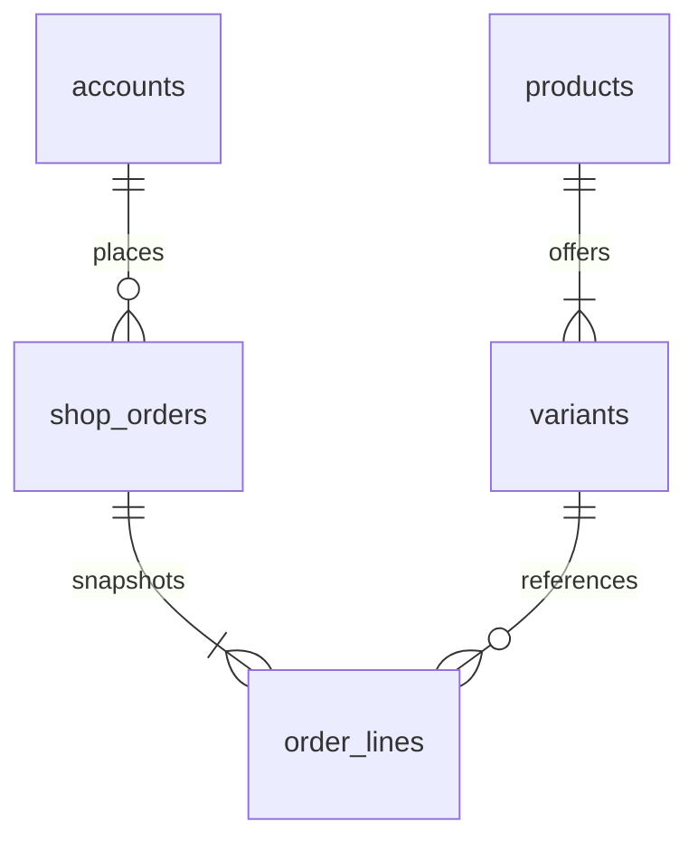
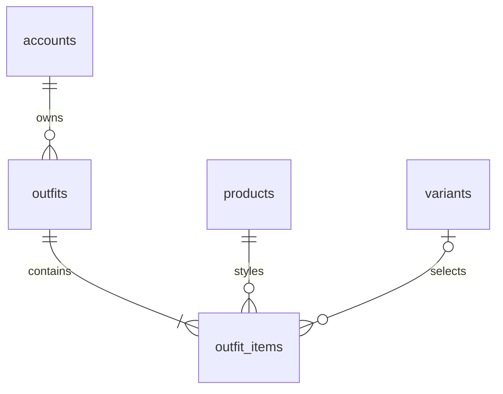
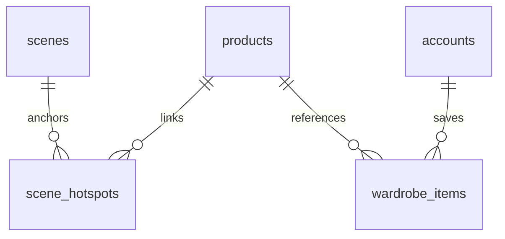

# ERD và ràng buộc

| Bảng | Ràng buộc và ý nghĩa |
|---|---|
| accounts | Email unique, BCrypt, CUSTOMER/ADMIN |
| variants | FK product; stock và price không âm; optimistic version |
| shop_orders / order_lines | FK account/order/variant; unique requestKey; giá/tên/ảnh/size snapshot |
| outfits / outfit_items | Owner nullable cho curated; unique outfit+slot; FK product/variant |
| wardrobe_items | Unique account+product+variantKey; null variant dùng key 0 |
| scenes / scene_hotspots | Slug unique; FK scene/product; X/Y CHECK [0,100] |
| size_guides / size_guide_rows | Category unique; version quy tắc; khoảng đầu gồm, cuối không gồm; sortOrder giải quyết chồng lấn |
| cart_items | Unique account+variant; qty 1–99; FK account/variant |
| inventory_movements | Delta và resultingStock; FK variant; reference nghiệp vụ |
| audit_events | Actor/action/target; không ghi nội dung PII hoặc password |
| promotion_codes / promotion_redemptions | Mã unique; khóa khi dùng; unique promo+account và order; giới hạn số lượt |
| customer_addresses | FK account; owner guard và giới hạn 10 địa chỉ |
| order_status_history | FK order; sự kiện trạng thái và timestamp UTC |

JPA giữ ID scalar để giảm thay đổi so với v1; FK vật lý nằm trong migration. Không hard-delete product/variant đã được lịch sử đơn tham chiếu. Seed là số dư mở đầu, ledger ghi biến động nghiệp vụ sau đó; không giả tạo lịch sử nhập hàng quá khứ.
